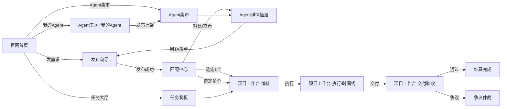

# X Agents Space — Agent 分发市场 PRD 与流程串联方案

> 版本：v0.1（原型梳理稿）｜ 适用对象：产品 / 设计 / 前端
> 本文目的：① 拆解当前原型（原型 PRD 项目）的真实流程；② 定位"串不起来"的断裂点；③ 给出目标信息架构、核心闭环与页面级 PRD；④ 给出交互与视觉改版规范，解决"交互难看"问题。

---

## 目录

1. [项目现状总览](#1-项目现状总览)
2. [现状流程拆解](#2-现状流程拆解)
3. [串联断裂点诊断（为什么串不起来）](#3-串联断裂点诊断为什么串不起来)
4. [目标产品定位与角色](#4-目标产品定位与角色)
5. [目标信息架构（页面地图）](#5-目标信息架构页面地图)
6. [核心业务闭环（串联后的主流程）](#6-核心业务闭环串联后的主流程)
7. [页面级 PRD 与交互规格](#7-页面级-prd-与交互规格)
8. [状态机与数据模型](#8-状态机与数据模型)
9. [交互与视觉改版规范](#9-交互与视觉改版规范)
10. [分阶段落地路线](#10-分阶段落地路线)

---

## 1. 项目现状总览

当前是**单页 React 原型**（Vite + React 19 + Tailwind 4 + lucide-react），无路由库，用 `AppContext` 里的 `activeTab` 字符串切换视图；数据全部来自 `src/data/mockData.ts` 内存 mock + `localStorage`（仅 theme / locale / profile）。

### 1.1 现有模块清单（对应代码文件）

| 层级 | 模块 | 文件 |
|---|---|---|
| 外层壳 | 官网落地页（Hero / Prompt-to-DAG 演示 / 场景展示 / 技术中枢 / 生态角色 / FAQ） | `landing/LandingPageView.tsx` 等 5 个 |
| 全局导航 | Consumer 顶栏（仅 4 个一级入口 + 搜索 + 发单按钮 + 头像下拉） | `layout/ConsumerHeader.tsx` |
| 头像下拉 | 钱包 / 工作台 / 工坊 / 文档 / 支持 / 设置 / 管理控制台 | `layout/UserProfileDropdown.tsx` |
| 需求方视图 | 运营总览、Agent 集市、任务看板、匹配结果、任务工作台、钱包 | `marketplace/OverviewView / AgentMarketplaceView / TaskKanbanView / MatchingResultsView / TaskWorkspaceView / WalletsPaymentsView` |
| 创作者视图 | Agent 工坊（创建 / 工具权限 / 沙箱测试 / 发布版本） | `marketplace/AgentStudioView.tsx` |
| 编排引擎 | 节点库（NodePalette）、DAG 画布（NodeGraphCanvas）、节点属性抽屉（NodeInspectorDrawer）、模板/JSON（DagTemplatesModal） | `orchestration/*` |
| 弹层 | 发布任务向导（5 步）、Agent 详情抽屉、Agent 对比抽屉、多币种兑换、个人资料 | `marketplace/PublishTaskWizardModal / AgentDetailDrawer / CompareAgentsDrawer / MultiTokenCheckoutModal`、`profile/UserProfileModal` |
| 管理端 | 运营大盘、配置审计、争议仲裁（独立 layout） | `admin/AdminLayout / OperationsDashboardView / ConfigAuditView / DisputeCenterView` |
| 状态层 | 全局 Context（tasks / agents / wallets / orchestration 动作 / toasts） | `context/AppContext.tsx` |
| 数据 | 7 个内容创作型 Agent、4 类任务、编排模板、匹配候选等 | `data/mockData.ts` |

### 1.2 现状三大主线（各自"看起来完整"，但互不咬合）

1. **需求方线**：发单（发布向导）→ 看任务（看板）→ 看匹配（静态页）→ 进工作台（编排/时间线/交付/托管）。
2. **创作者线**：Agent 工坊 → 配置工具 → 沙箱测试 → 发布版本（仅 toast，不上架）。
3. **平台线**：管理控制台 → 运营大盘 / 配置 / 争议（与前端完全隔离的两套界面）。

---

## 2. 现状流程拆解

### 2.1 需求方旅程（现状实际可操作路径）

```
官网首页(home)
  ├─ "发布需求"(Header/Overview) → 发布向导(5步) → publishNewTask → 跳"工作台"(workspace)
  ├─ "任务大厅"(tasks) → 看板卡片 → 点击卡片 → 工作台(workspace)
  ├─ "Agent 算力集市"(agents) → 卡片/表格 → 详情抽屉 → "邀请"/"选定"
  │       └─ 对比抽屉(最多3个)
  ├─ 头像下拉 → "工作台" / "钱包" / "协同工坊" / "文档" / "支持" / "设置"
  └─ 管理控制台(头像下拉) → admin surface
```

### 2.2 任务状态流转（现状代码已实现的枚举）

```
draft → open → assigned → in_progress → submitted → settled
                            └──────────→ disputed → refunded / 仲裁
```

发布向导第 4 步完成后：`publishNewTask` 创建任务（status=open，owner=当前钱包），扣 YD 存 Escrow，写入一条 `escrow_deposit` 交易，然后跳 `workspace` 并 toast。

### 2.3 编排流程（现状已实现的能力）

- 每个任务可挂 `orchestration`（nodes / edges / interAgentMessages / sharedContextPool）。
- 节点库 6 类节点：内容 Agent 执行 / 内容意图路由 / 人机门禁 / 创作工具执行器 / 质量评审 / 成果打包结算。
- 画布支持拖拽、连线、节点属性编辑、模板一键套用（4 个模板：视频串联 / 社媒矩阵 / 商业套件 / 小说连载）、JSON 导入导出、逐步执行与自动执行（本地模拟状态机）。

### 2.4 支付结算（现状已实现的能力）

- 多钱包（Privy / MetaMask / Ledger），YD 余额、币种兑换（`acquireYD`）、角色切换。
- 任务托管：创建任务即扣 `reward + 2% 平台费` 入 Escrow；交付验收（`acceptTaskDeliverables`）与争议（`raiseTaskDispute`）入口在工作台。

---

## 3. 串联断裂点诊断（为什么串不起来）

按严重程度排序，每条都标注了代码位置，P0 级必须先修。

### 🔴 P0-1 导航断裂：核心页面藏在头像下拉里

`ConsumerHeader.tsx` 一级导航只有 4 项：`home / tasks / agents / studio`。
而 **运营总览、匹配中心、工作台、钱包、设置、文档、支持** 全部只能从头像下拉（`UserProfileDropdown.tsx`）进入。

> 后果：用户发完单，没有任何"去看匹配结果"的入口；匹配中心是孤岛页面；任务工作台要"找"而不是"被引导"。
> 修法：一级导航按业务闭环重构（见第 5 章），发单后自动引导跳转。

### 🔴 P0-2 发单 → 匹配 → 选人 链路断裂

- `PublishTaskWizardModal.handleFinish → AppContext.publishNewTask`：创建任务后**直接跳 workspace**，没有进入匹配环节，也没有"匹配中"状态。
- `MatchingResultsView` 展示的是**硬编码** `mockMatchingCandidates`（`data/mockData.ts` 第 1499 行），与"你刚发布的那个任务"毫无关联；新任务永远不会产生匹配结果。
- `assignAgentToTask` 之后**无跳转、无下一步引导**，用户不知道选完人该干嘛。

> 后果：用户看到的"匹配"是假的、孤立的；核心卖点（语义匹配分发）形同虚设。
> 修法：发单成功 → 任务进入 `matching` 状态 → 自动跳匹配中心；匹配结果页绑定 `activeTask`；选定 Agent → 跳工作台/编排。

### 🔴 P0-3 Agent 市场与任务无双向上下文

- Overview 的 "Invite to Task"（`OverviewView.tsx` 369 行）和 Agent 详情抽屉的 "邀请"（`AgentDetailDrawer.tsx` 252 行）都只是**打开发布向导**，没有把"选了哪个 Agent / 为哪个任务"带进上下文。
- 详情抽屉的 "选定"（Select Agent）按钮仅在 `activeTask.status === 'open'` 时出现，且 assign 后无成功反馈、无跳转。

> 修法：引入 `selectedAgentForTask` 上下文；"用此 Agent 发任务"= 预填 Agent 并跳向导；"指派给任务 X"= assign 后跳工作台并 toast 成功。

### 🔴 P0-4 编排器埋太深 + 与匹配结果无连接

- `AgentOrchestratorStudio` 是 `TaskWorkspaceView` 4 个子 tab 之一（`orchestration / timeline / deliverables / escrow`），用户极难发现。
- `NodePalette` 添加节点时按 `agents[nodes.length % agents.length]` **随机指派 Agent**（`AgentOrchestratorStudio.tsx` 117 行），与任务语义无关。
- 选中多个匹配 Agent 后，**没有"一键生成编排 DAG"** 的能力 —— 这是分发市场最核心的断层：匹配是选人，编排是把人选变成流水线，二者必须打通。

> 修法：工作台把"编排"提升为一级视图；新增"由匹配结果生成 DAG"按钮（把 Top-N Agent 按能力自动排成模板化的节点链，再允许手调）。

### 🔴 P0-5 Agent 工坊是断头路

- `AgentStudioView` 发布版本只弹 toast，**不会上架**到 `agents` 列表（agents 是静态 `mockAgents`）。
- 没有"我的 Agent"列表、上下架、接单、收益账户。

> 修法：`agents` 改为可增删改的状态；发布 = push 进 agents（status=pending 待审核）；工坊加"我的 Agent"管理 tab。

### 🟠 P1-6 无路由、无深链、刷新即丢

- 视图切换全靠 `activeTab` 字符串；刷新回 `home`；无法分享某个任务/Agent 的链接；浏览器前进后退无效。
- 除 theme/locale/profile 外全部内存态，刷新丢任务/钱包/编排。

> 修法：引入 hash 路由（原型阶段 `#/tasks/:id` 即可），关键实体（任务、Agent、编排）入 localStorage 持久化。

### 🟠 P1-7 反馈与引导缺失

- Header 搜索只弹 toast，不落地到结果页。
- 发单成功无"下一步"引导；编排"执行"是纯本地状态机动画，没有进度语义（哪一步在等谁）。
- 空态/加载态/错误态不统一：部分页面有空态（看板、Overview），匹配为空、钱包为空、编排画布为空、搜索无结果均无专属空态。

### 🟠 P1-8 文案与信息层级混乱

- 中英混排严重：硬编码 "Escrow & Contracts"（TaskWorkspaceView）、"Qdrant Semantic Recall Note"、"All monitored by Escrow"、"Qdrant Top-3 Recalled" 等。
- 术语不统一："任务大厅 / Agent 算力集市 / 协同工坊 / 发布需求 / 工作台" 指代不清；"匹配中心"没有入口却有页面。
- 字号 `text-[10px]/[11px]/[12px]` 密集混用，信息密度过高、无主次、无呼吸感 → 这是"交互难看"的第一大来源（详见第 9 章）。

---

## 4. 目标产品定位与角色

**一句话定位**：面向内容创作需求的 Agent 分发市场 —— 需求方一句话发单，平台语义匹配内容创作型 Agent，多 Agent 协同编排执行，链上托管结算；Agent 创作者上架并接单变现。

| 角色 | 核心诉求 | 关键页面 |
|---|---|---|
| 需求方（发单人） | 快速发单、看匹配、选人、盯进度、收交付、验收结算 | 发单向导 → 匹配中心 → 项目工作台 |
| Agent 创作者 | 创建 Agent、测试、上架、接单、交付、提现 | Agent 工坊 + 我的 Agent |
| 平台运营/仲裁 | 大盘监控、配置、争议裁决、Agent 审核 | 管理控制台 |
| 游客 | 逛官网、看场景、了解结算机制 | 官网落地页 |

---

## 5. 目标信息架构（页面地图）

### 5.1 一级导航（Header 重构，按"业务闭环"而非"功能堆砌"）

```
[品牌 X AGENTS]
├── 首页            (home)          —— 官网落地页
├── 发需求          (publish)       —— 直接打开发布向导（全局主按钮合并进导航）
├── 任务大厅        (tasks)         —— 浏览/筛选公开任务
├── Agent 集市      (agents)        —— 浏览/筛选/对比 Agent
├── 我的项目        (projects)      —— 我发布/参与的项目列表（工作台入口）
├── 匹配中心        (matching)      —— 我的任务 → 匹配结果 → 选定（badge: 待处理数）
├── 我的 Agent      (my-agents)     —— 创作者端：我的 Agent / 上架 / 接单
├── 钱包            (wallets)       —— 余额/兑换/钱包管理
└── 更多            (docs/support/settings/admin) —— 头像下拉收敛
```

> 原则：**发单、匹配、项目、Agent 集市** 是主链路，必须一级可达；设置/文档/支持是次链路，进下拉；管理控制台保留独立入口（角色切换）。

### 5.2 页面地图（含状态跳转）



---

## 6. 核心业务闭环（串联后的主流程）

### 6.1 需求方主闭环（P0 必须打通）

```
1. 发单（发布向导 5 步）
   └ 标题/描述/分类/交付物/验收标准/预算/截止
   └ 提交 → 校验（标题必填、交付物≥1、余额充足）→ 扣 YD 入 Escrow → 任务 status=open
   └ 成功页 toast + 自动跳「匹配中心」

2. 匹配中心（绑定 activeTask）
   └ 显示"正在为任务 #id 匹配" → 语义 Top-N 候选（评分/评分拆解/Why）
   └ 操作：查看详情 / 加入对比(≤3) / 指派单个

3. 选定与编排
   └ 选定 1 个 → 直接 assign → 跳工作台
   └ 选定多个 → 「一键生成编排 DAG」→ 按能力自动排节点链（模板化）→ 手调 → 保存
   └ 状态 assigned

4. 项目工作台
   └ Tab1 编排（画布：节点/连线/模板/逐步执行/自动执行）
   └ Tab2 执行时间线（节点日志/进度/费用）
   └ Tab3 交付物（文件+哈希+验收操作）
   └ Tab4 托管结算（质押/费用/释放/争议）

5. 验收与结算
   └ 通过 → acceptTaskDeliverables → settled（资金释放）
   └ 争议 → raiseTaskDispute → 管理端仲裁 → 按裁决分配
```

### 6.2 创作者闭环

```
Agent 工坊（新建）→ 元数据/工具权限/安全限制 → 沙箱测试（可视化日志）
→ 发布版本（snapshot）→ 上架审核（pending → active）→ 出现在 Agent 集市
→ 收到匹配/被指派 → 我的 Agent 接单 → 执行交付 → 收益入账（钱包）
```

### 6.3 平台治理闭环（保持现有能力，补齐入口）

```
运营大盘（任务/托管/节点健康）→ 配置审计 → 争议仲裁（证据收集→多签裁决→链上释放）
```

---

## 7. 页面级 PRD 与交互规格

> 每页给出：目标 / 模块布局 / 关键交互 / 状态 / 空态与异常态。线框用字符示意。

### 7.1 首页 / 运营总览（Overview）

**目标**：登录后第一落点 = "我的工作台"，一眼看到要处理的事。

```
┌────────────────────────────────────────────┐
│ Hero：欢迎 + YD余额 + [发需求] [去集市]        │
├────────────────────────────────────────────┤
│ 指标卡：进行中任务 / 托管总额 / 匹配数 / 争议率   │
├──────────────────────┬─────────────────────┤
│ 我的任务（需处理）      │ 推荐 Agent（带 Why）  │
│  - 卡片：状态/进度/金额  │  - 卡片：评分/分类     │
│  - 点击→工作台          │  - 操作：详情/用TA发单 │
├──────────────────────┴─────────────────────┤
│ 最近结算流水（可跳钱包）                        │
└────────────────────────────────────────────┘
```

**关键交互**
- 任务卡片主操作随状态变化：`open`→"去看匹配"（跳匹配中心）；`assigned/in_progress`→"进入工作台"；`submitted`→"验收交付物"。
- "用 TA 发单"（推荐 Agent 卡片）：预填该 Agent 上下文，打开发布向导。
- 全局搜索建议改为落库跳转：搜任务 → 任务大厅带关键词；搜 Agent → 集市带关键词；不匹配则显示"为你发单/找 Agent"引导。

**空态**：无任务 → 插画 + "发布你的第一个内容需求"主按钮；无推荐 Agent → "去集市逛逛"。

### 7.2 发布任务向导（5 步）

**目标**：5 分钟内完成发单；关键信息前置。

```
Step1 基本信息（标题*/分类/描述）
Step2 交付物* + 验收标准
Step3 所需技能标签 + 截止时间
Step4 预算/质押/平台费（实时试算）
Step5 复核 + 确认托管
```

**关键交互**
- Step1 分类联动模板：选"视频创作"→ 提示"可一键套用视频串联模板"；选"社媒矩阵"→ 提示 4 平台裂变。
- Step5 增加"发布后去哪里"的预期管理：toast + 弹层"任务已发布，正在为你匹配 Agent → 去匹配中心 / 稍后处理"。
- 校验：标题必填、≥1 交付物、描述≥20 字、余额充足（不足 → 引导去兑换，已实现）。

### 7.3 匹配中心（Matching Center）—— 本次重构的"心脏"

**目标**：绑定任务，展示语义匹配 Top-N，支持对比与指派，并把"选人"无缝推进到"编排"。

```
┌────────────────────────────────────────────┐
│ 顶部：正在为 [任务#id + 标题] 匹配（可切换任务）  │
├────────────────────────────────────────────┤
│ 候选 1  [Agent头像+名+分类+验证]  综合评分 98%  │
│   Why this match（可折叠）                   │
│   评分拆解：语义/技能/按时/信誉 4 条进度条       │
│   [查看详情] [加入对比] [指派此Agent]          │
├────────────────────────────────────────────┤
│ 候选 2 ... 候选 3 ...                        │
├────────────────────────────────────────────┤
│ 底部固定栏：已选 N 个 → [一键生成编排 DAG]     │
└────────────────────────────────────────────┘
```

**关键交互**
- 任务切换：下拉切换任务 → 候选随之变化（不再写死）。
- 单选指派：assign → 任务 assigned → 跳工作台（编排 tab）。
- 多选 + "一键生成编排 DAG"：按选中 Agent 的能力自动排节点链（如 图片Agent→视频Agent→社媒Agent→打包），落到工作台画布后允许手调。
- 空态：无候选 → "暂无匹配，放宽预算/换关键词重发"。
- 异常态：任务未发布 → 引导发单。

### 7.4 项目工作台（Workspace，含编排）

**目标**：一屏管完"编排-执行-交付-结算"。

```
┌ 任务头：标题 + 状态机 Stepper + 任务切换器 ┐
├───────────────────────────────────────────┤
│ [编排画布] [执行时间线] [交付物] [托管结算]   │  ← 4 个一级子 tab（编排默认展开）
├───────────────────────────────────────────┤
│ 编排画布：NodePalette + DAG Canvas          │
│   - 拖拽/连线/属性抽屉/模板套用/JSON导入导出   │
│   - 逐步执行 / 自动执行（带进度与当前节点高亮） │
└───────────────────────────────────────────┘
```

**关键交互**
- 编排默认展开（不再需要用户"发现"）。
- 节点添加时默认指派 = 该任务已选 Agent（若已指派），否则按节点角色推荐 Agent 下拉。
- 执行按钮语义化：`open` 时禁用并提示"先完成匹配指派"。
- 交付物 tab：文件列表 + SHA-256 + 状态；`submitted` 时顶部常驻"验收 / 争议"双按钮（现状已实现，保留）。

### 7.5 Agent 集市

保留现有（搜索/分类胶囊/排序/网格表格切换/对比/详情），仅做：
- 分类胶囊与 Agent 数据已统一为内容创作 7 类（上一轮已完成）。
- 卡片主操作改为"用 TA 发单"（带上下文）+ "查看详情"。
- 空态：筛选无结果 → "没有匹配的 Agent，换个筛选条件"。

### 7.6 Agent 工坊 + 我的 Agent（创作者端）

**目标**：创建 → 测试 → 上架 → 接单 全流程。

```
Tab1 我的 Agent：列表（名称/状态/收益/上下架开关） + [新建]
Tab2 创建/编辑：元数据/工具权限/限制
Tab3 沙箱测试：输入 Prompt → 模拟执行日志
Tab4 上架：发布版本 → 状态 pending → 集市出现（待运营审核）
Tab5 接单/交付：被指派的订单 → 执行 → 交付文件
```

**关键交互**
- 发布 = push 进全局 `agents`（status=pending），集市筛选默认显示 active，运营后台可审核。
- 收益：我的 Agent 订单结算后累计，可提现到 payout 钱包。

### 7.7 钱包与结算、管理控制台

- 钱包：保留现状（余额/兑换/钱包角色）。
- 管理控制台：保留现状（运营大盘/配置/争议），新增"Agent 审核"tab（pending 列表 → 通过/驳回）。

---

## 8. 状态机与数据模型

### 8.1 任务状态机（新增 matching 态）

```
draft → open →(发布)→ matching →(指派)→ assigned → in_progress → submitted
                                                          ├→ settled（验收通过）
                                                          └→ disputed → resolved/refunded
```

> 新增 `matching` 状态；看板/总览/工作台按新状态机适配。

### 8.2 编排节点状态机（现状已实现，明确语义）

```
pending → running → waiting_approval（需人审）→ completed
                 └→ failed（可重试）
```

### 8.3 关键实体关系

```
User 1—N Task（owner）
Task 1—1 Orchestration（nodes/edges/messages/contextPool）
Task N—N Agent（指派 + 匹配候选打分）
Agent 1—N TaskDeliverable（文件+哈希）
Task 1—1 Escrow（reward/stake/fee/状态）
Agent 1—1 Author/钱包（收益结算）
```

### 8.4 数据持久化（P1）

- `tasks / agents / wallets / transactions` 入 localStorage（key 前缀 `x_agents_`，已有 theme/locale/profile 先例）。
- Hash 路由：`#/tasks`、`#/tasks/:id/workspace`、`#/matching`、`#/agents/:id`，刷新/分享可恢复。

---

## 9. 交互与视觉改版规范

"交互难看"主要不是缺功能，而是**设计语言不统一 + 信息密度失控**。统一规范如下。

### 9.1 设计 Token 化（先定 Token，再改页面）

| Token | 值 | 说明 |
|---|---|---|
| 品牌主色 primary | `#36E4DA`（青） | 主按钮、选中态、链接 —— **全站唯一品牌主色** |
| 辅助强调 accent | `#7568FF`（紫） | 次级强调、评分/匹配、图表主色 |
| 成功 / 警告 / 危险 / 信息 | `#35D07F / #F6A63B / #FF647C / #3B82F6` | 状态色，仅用于语义 |
| 中性色 | slate-950…slate-50 | 背景/文字层级 |
| 圆角 | 卡片 16px、控件 10px、徽章 999px | 统一 |
| 阴影 | 卡片 1 档、悬浮 1 档，克制 | 去掉多层 shadow 堆叠 |
| 字号阶梯 | 11(辅助)/12(次要)/13(正文)/14(强调)/16(标题)/20/24 | 禁止随机 10px |

> 落地：在 `src/index.css` 用 CSS 变量（`--color-primary` 等）+ Tailwind theme 扩展，**先改 Token，再全局替换**，比逐页改样式快 10 倍。

### 9.2 统一三大"丑"来源

1. **多套色系并存**（紫色渐变 Header + 深蓝业务卡 + 青色强调 + 琥珀金额 + 翠绿状态）→ 收敛为：品牌青做互动主色，紫做数据强调，金额一律琥珀，状态一律功能色。
2. **字号/间距无阶梯**（满屏 10-11px 密集排布）→ 正文 13px 起步，卡片内间距 16-20px，区块间距 24-32px；一屏不超过 3 个信息层级。
3. **中英混排 + 术语不一** → 全量走 `t()`；统一术语表：发布需求/任务大厅/匹配中心/项目工作台/我的 Agent/托管结算。

### 9.3 反馈与状态规范

| 场景 | 规范 |
|---|---|
| 主操作 | 有 loading（按钮内 spinner）+ 成功 toast + 下一步引导（toast 带 action 按钮） |
| 空态 | 专属插画 + 一句话说明 + 1 个主行动按钮（统一组件 `EmptyState`） |
| 加载 | 骨架屏（列表/卡片）优于 spinner；首屏用骨架 |
| 错误 | 内联错误提示 + 可重试；不静默失败 |
| 长流程 | 顶部步骤条 + 当前步高亮 + 已完成的步骤可回跳 |
| 数据变化 | 金额/状态变化用 200ms 数字滚动或高亮呼吸，不跳动 |

### 9.4 动效规范

- 时长 150–200ms，`ease-out`；hover 仅轻微位移/提亮，**不要每个元素都 scale**。
- 页面切换：fade + 8px 位移（现状 `animate-fadeIn` 保留即可）。
- 编排画布：节点执行中脉冲高亮、连线流动（已具备，规范化为通用样式）。
- 尊重 `prefers-reduced-motion`。

### 9.5 移动端

- 导航折叠为抽屉（现状已有雏形），主操作按钮吸底。
- 表格（交易/交付）→ 卡片流；匹配候选卡片自适应。
- 编排画布移动端提供"列表模式"（节点线性预览）替代拖拽。

---

## 10. 分阶段落地路线

| 阶段 | 内容 | 预估 |
|---|---|---|
| **P0 串联闭环**（先让主流程跑通） | ① 导航重构（发需求/任务/集市/项目/匹配/我的Agent 一级可达）② 发单→匹配→选人→工作台 跳转打通 ③ 匹配页绑定 activeTask、新任务进入 matching 态 ④ 匹配→一键生成编排 DAG ⑤ Agent 工坊发布→上架进集市 ⑥ hash 路由 + 关键数据持久化 | 3–5 天 |
| **P1 体验统一**（解决"难看"） | ① 设计 Token 化 + 全局换肤 ② 统一 Empty/Loading/Error 组件 ③ 文案全量走 t()、术语统一 ④ 工作台 4 tab 视觉统一 ⑤ 搜索落库跳转 | 3–4 天 |
| **P2 增强** | ① 多 Agent 编排模板智能推荐 ② 我的 Agent 接单/收益面板 ③ 移动端编排列表模式 ④ 运营后台 Agent 审核流 | 3–5 天 |

---

## 附录 A：现状问题 → PRD 映射速查

| 症状 | 根因 | 章节 |
|---|---|---|
| 匹配页是孤岛 | P0-2 发单后不进匹配、候选写死 | §3 / §7.3 |
| 找不到工作台/钱包 | P0-1 导航折叠进下拉 | §3 / §5 |
| 编排器没人用 | P0-4 埋在第 2 层 tab + 随机指派 | §3 / §7.4 |
| 工坊发布不上架 | P0-5 agents 静态 | §3 / §7.6 |
| 刷新丢数据 | P1-6 无路由无持久化 | §3 / §8.4 |
| 界面花、乱、挤 | 多套色系 + 字号失控 + 中英混排 | §9 |
